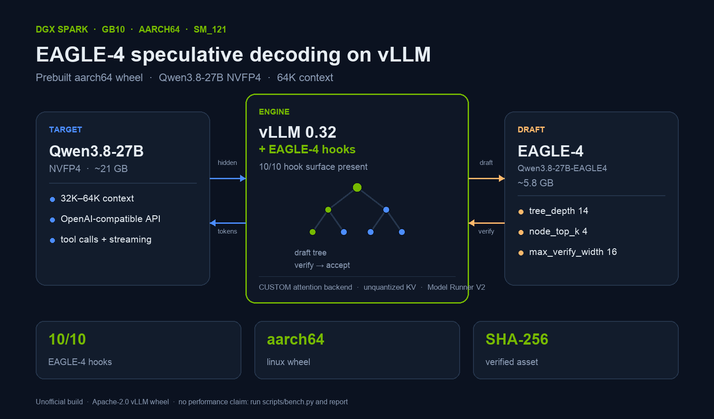

<h1 align="center">vLLM + EAGLE-4 on DGX Spark</h1>

<p align="center"><b>Prebuilt <code>aarch64</code> wheel for NVIDIA GB10 (sm_121) · Python 3.12</b></p>

<p align="center">
  <a href="https://github.com/Bobbinetor/vllm-eagle4-aarch64-gb10/releases/latest"></a>
  <a href="https://github.com/Bobbinetor/vllm-eagle4-aarch64-gb10/actions/workflows/ci.yml"></a>
  <a href="https://github.com/Bobbinetor/vllm-eagle4-aarch64-gb10/actions/workflows/release-verify.yml"></a>
  
  
  
  
  
</p>

<p align="center"><a href="README.it.md">Leggi in italiano</a></p>

> **What this is:** a prebuilt `linux_aarch64` wheel of the EAGLE-4-patched vLLM fork, for NVIDIA DGX Spark / GB10. It is the arm64 counterpart to the official x86_64-only EAGLE-4 wheels.
>
> **Where to get it:** the wheel is attached to the **[latest GitHub Release](https://github.com/Bobbinetor/vllm-eagle4-aarch64-gb10/releases/latest)**, not committed to git (494 MB is above GitHub's 100 MB repository file limit). The release also carries `SHA256SUMS`, and a CI job re-downloads and verifies every published asset.
>
> **What this is not:** an official Eagle AI Corp. or NVIDIA release. The wheel is an Apache-2.0 vLLM build. `eagle-harness` and the EAGLE-4 draft model are separate downloads under the [Eagle 4 Source-Available License](https://github.com/eagle-hq/EAGLE-4/blob/main/LICENSE).

---

## Status

**Built and smoke-tested on 2026-10-30** on a DGX Spark (GB10, 121 GB unified memory, Ubuntu 24.04.5, driver 580.159.03, CUDA 13.0):

- `eagle-harness-check` reports every required hook present.
- OpenAI-compatible chat, tool calls, streaming, and the long-context smoke case in the 64K-context configuration pass.

Throughput is **not published yet**. The first numbers came from a single machine and were not independently reproducible, so they were withdrawn. Run [`scripts/bench.py`](scripts/bench.py) on your GB10 and open a run report: verified results will be listed here with the hardware and the method. See [Benchmarks](#benchmarks).

Independent reproduction is invited. See [Report your run](#report-your-run).

---

## Why this exists

The DGX Spark is `aarch64` with a GB10 GPU (compute capability 12.1 / sm_121). The official EAGLE-4 artifacts are x86_64-only:

| Official EAGLE-4 artifact | Architecture |
|---|---|
| [`eagle-hq.github.io/EAGLE-4/whl/cu130/vllm/`](https://eagle-hq.github.io/EAGLE-4/whl/cu130/vllm/) | `manylinux_2_28_x86_64` only |
| [`ghcr.io/eagle-hq/eagle-4-vllm:0.1.3`](https://github.com/eagle-hq/EAGLE-4/pkgs/container/eagle-4-vllm) | `linux/amd64` only |
| [EAGLE-4 install docs](https://github.com/eagle-hq/EAGLE-4/blob/main/docs/install.md) | "Linux x86-64 and Python 3.12" |
| **This repository** | **`linux_aarch64`, cp312, sm_121** |

Stock aarch64 vLLM wheels also do not carry the EAGLE-4 hook surface. This repository is a source build of [`eagle-hq/vllm`](https://github.com/eagle-hq/vllm) at tag [`eagle/v0.1.0`](https://github.com/eagle-hq/vllm/releases/tag/eagle/v0.1.0) (commit [`3ba2380`](https://github.com/eagle-hq/vllm/commit/3ba23801e80d2a0d0a9af21ce94484aa2adb8795)), compiled with `TORCH_CUDA_ARCH_LIST=12.1a`, `MAX_JOBS=16`, and the exact flash-attention, CUTLASS, and DeepGEMM pins recorded in [the build document](docs/it/EAGLE4-BUILD.md).

`eagle-harness` 0.1.4 accepts `vllm>=0.32.0rc1.dev283,!=0.32.0`, so this `+eagle.3` build passes the hook check. Upstream's current reference build is `+eagle.5` (`main 074c83a09a` + hooks and fixes). The hook contract is the same; if you need the exact `+eagle.5` reference, rebuild from that commit with the same recipe.

If you are on x86_64, use the official wheel. If you are on another ARM GPU (GH200, Grace Hopper, Jetson), this wheel is not for you: it is built for sm_121 and for the CUDA 13 userspace of the DGX Spark image.

---

## At a glance

| | |
|---|---|
| **Artifact** | `vllm-0.32.0rc1.dev283+eagle.3-cp312-cp312-linux_aarch64.whl` |
| **Size** | 494,300,662 bytes (471 MiB); 1.75 GB and 5,542 files unpacked |
| **SHA-256** | `fbd7ec77a34f608b4158d7a7196f75a1f78100da3645825e0a30657f72408237` |
| **Wheel tag** | `cp312-cp312-linux_aarch64` |
| **vLLM** | `0.32.0rc1.dev283+eagle.3` |
| **Built from** | `eagle-hq/vllm` @ `3ba23801e80d2a0d0a9af21ce94484aa2adb8795` (tag `eagle/v0.1.0`) |
| **Base image** | `vllm/vllm-openai:latest` @ `sha256:c1c9f6fd5c109ba7f0546a59f5b2f15fb87f64c77782e90a27b648b42a8e67c3` |
| **CUDA arch** | `12.1a` (sm_121, GB10) |
| **Python** | 3.12 |
| **Harness** | `eagle-harness` 0.1.4 (installed separately from PyPI) |
| **Target model** | [`nvidia/Qwen3.8-27B-NVFP4`](https://huggingface.co/nvidia/Qwen3.8-27B-NVFP4) (~21 GB) |
| **Draft model** | [`EAGLE-Corp/Qwen3.8-27B-EAGLE4`](https://huggingface.co/EAGLE-Corp/Qwen3.8-27B-EAGLE4) (~5.8 GB) |



---

## Quick start

The wheel is a release asset. Download it together with the checksum manifest:

```bash
# 1. Download the wheel and the checksums from the GitHub Release
#    (run from the repository root; `git clone` first if you have not)
gh release download v0.1.0 \
  --repo Bobbinetor/vllm-eagle4-aarch64-gb10 \
  --pattern '*.whl' --pattern 'SHA256SUMS'

# No gh CLI? Use curl instead:
# curl -fLO https://github.com/Bobbinetor/vllm-eagle4-aarch64-gb10/releases/download/v0.1.0/vllm-0.32.0rc1.dev283+eagle.3-cp312-cp312-linux_aarch64.whl
# curl -fLO https://github.com/Bobbinetor/vllm-eagle4-aarch64-gb10/releases/download/v0.1.0/SHA256SUMS

# 2. Verify the wheel (the manifest also covers the recipe files, hence --ignore-missing)
sha256sum -c --ignore-missing SHA256SUMS

# 3. Build the image (~2-3 min; the wheel is already compiled)
docker build -f docker/Dockerfile.eagle -t vllm-eagle:gb10 .

# 4. Download the models once (~27 GB)
hf download nvidia/Qwen3.8-27B-NVFP4
hf download EAGLE-Corp/Qwen3.8-27B-EAGLE4

# 5. Serve
docker run -d --name vllm-eagle \
  --gpus all --ipc=host --network host \
  -e HF_HUB_OFFLINE=1 \
  -e VLLM_USE_V2_MODEL_RUNNER=1 \
  -v ~/.cache/huggingface:/root/.cache/huggingface \
  vllm-eagle:gb10 \
  nvidia/Qwen3.8-27B-NVFP4 \
  --served-model-name qwen3.8-27b-eagle \
  --port 8000 \
  --max-model-len 65536 \
  --gpu-memory-utilization 0.45 \
  --max-num-seqs 4 \
  --speculative-config '{"method":"eagle_harness","model":"EAGLE-Corp/Qwen3.8-27B-EAGLE4","method_config":{"mode":"static","node_top_k":4,"tree_depth":14,"max_verify_width":16}}' \
  --attention-backend CUSTOM \
  --language-model-only \
  --trust-remote-code \
  --enable-auto-tool-choice \
  --tool-call-parser qwen3_coder \
  --enable-prefix-caching
```

> Prefer the web UI? Open the **[Releases page](https://github.com/Bobbinetor/vllm-eagle4-aarch64-gb10/releases)** and download the `.whl` and `SHA256SUMS` from the latest release.

First start takes **~10–11 minutes** (CUDA graph capture and model load). Follow it with:

```bash
docker logs -f vllm-eagle
```

You should see:

```text
Resolved architecture: LlamaForCausalLMEagle4
eagle-harness: registered speculative method eagle_harness and draft LlamaForCausalLMEagle4
```

Then:

```bash
./scripts/smoke.sh
```

---

## What is in the repository

| Path | What it is |
|---|---|
| `vllm-...whl` | The prebuilt aarch64 wheel — attached to the **[GitHub Release](https://github.com/Bobbinetor/vllm-eagle4-aarch64-gb10/releases/latest)**, not stored in git |
| `docker/Dockerfile.eagle` | Installs the wheel + `eagle-harness[vllm]`, then runs `eagle-harness-check` |
| `build/build-eagle.sh` | Exact reproducible build recipe with all pins |
| `configs/qwen3.8-27b-eagle.yaml` | The validated service profile (for launcher-based setups) |
| `scripts/verify.sh` | Checks arch, Python, checksums, wheel tag, and hooks |
| `scripts/audit_hooks.py` | **Static** hook audit: verifies the 10 hooks `eagle-harness` 0.1.4 needs, without a GPU |
| `scripts/smoke.sh` | Health, models, chat, tool call, streaming, long context |
| `scripts/bench.py` | Optional benchmark script: run it and report your numbers |
| `scripts/release.sh` | Dry-run-first release helper: checks, tags, and uploads assets with `gh` |
| `docs/VERIFICATION.md` | The evidence: checksums, hook table, runtime logs, what was and was not tested |
| `docs/BENCHMARKING.md` | How to measure and report results (no published numbers yet) |
| `docs/TROUBLESHOOTING.md` | Every error encountered during the build, with fixes |
| `docs/LICENSING.md` | Component licenses, trademark policy, commercial-use note |
| `docs/releases/v0.1.0.md` | The release notes published on the GitHub Release page |
| `docs/it/` | Original Italian build and usage documents, preserved for provenance |
| `README.it.md` | Italian quick start |
| `CHANGELOG.md` | Build and version history |
| `NOTICE`, `licenses/` | Attribution and third-party license texts |
| `.github/` | CI, release automation, post-release asset verification, issue templates |

---

## Compatibility

### Tested

| Component | Value |
|---|---|
| Hardware | NVIDIA DGX Spark, GB10, 121 GB unified memory |
| Compute capability | 12.1 (sm_121) |
| OS | Ubuntu 24.04.5 LTS (DGX OS) |
| Driver | 580.159.03 (CUDA 13.0) |
| Python | 3.12 |
| Base image | `vllm/vllm-openai:latest` @ `c1c9f6f...` (2026-10-03) |
| vLLM | `0.32.0rc1.dev283+eagle.3` |
| `eagle-harness` | 0.1.4 |
| PyTorch | 2.14.0+cu130 in the final image (the wheel was built against 2.13.0) |

### Not supported

- **x86_64** — use the official EAGLE-4 wheel index instead.
- **Other ARM GPUs** — GH200, Grace Hopper, Jetson, and other non-sm_121 parts have a different compute capability and CUDA userspace. This wheel is sm_121 only.
- **Python 3.11 or 3.13** — the wheel is `cp312`.
- **Other vLLM versions** — the EAGLE-4 hook contract is pinned. Do not upgrade vLLM inside the image.
- **Quantized KV cache** — the EAGLE-4 tree verification in this build requires an unquantized KV cache. Do not add `--kv-cache-dtype fp8`.
- **Multi-GPU** — this build was validated on one GB10. The vLLM fork supports tensor parallelism, but the profile and the measurements are single-device.

---

## Verify it works

### Health and model list

```bash
curl -s http://127.0.0.1:8000/health
curl -s http://127.0.0.1:8000/v1/models | python3 -m json.tool
```

### Chat

```bash
curl -s http://127.0.0.1:8000/v1/chat/completions \
  -H 'Content-Type: application/json' \
  -d '{"model":"qwen3.8-27b-eagle","messages":[{"role":"user","content":"Reply with OK only"}],"max_tokens":32}' \
  | python3 -c "import sys,json;print(json.load(sys.stdin)['choices'][0]['message']['content'])"
```

### Tool call

The response must contain `tool_calls`, not plain text:

```bash
curl -s http://127.0.0.1:8000/v1/chat/completions \
  -H 'Content-Type: application/json' \
  -d '{"model":"qwen3.8-27b-eagle","messages":[{"role":"user","content":"Weather in Rome? use get_weather"}],"tools":[{"type":"function","function":{"name":"get_weather","parameters":{"type":"object","properties":{"city":{"type":"string"}},"required":["city"]}}}],"max_tokens":512}' \
  | python3 -c "import sys,json;m=json.load(sys.stdin)['choices'][0]['message'];print(m.get('tool_calls'))"
```

### Static hook audit (no GPU needed)

```bash
python3 scripts/audit_hooks.py vllm-0.32.0rc1.dev283+eagle.3-cp312-cp312-linux_aarch64.whl
```

This opens the wheel as a zip and checks the exact symbols `eagle-harness` 0.1.4 resolves at load time. It is the fastest way to confirm that a wheel is the patched build and not a stock vLLM. On a machine that is not a DGX Spark, `./scripts/verify.sh --static` runs the checksum and the audit without the host/GPU checks.

### Release integrity

Every published release is verified twice:

- `ci.yml` runs the static checks (links, checksums of tracked files, script syntax) on every push.
- `release-verify.yml` runs after a release is published: it downloads the published wheel from the release, verifies `SHA256SUMS`, and re-runs the 10-hook audit on the downloaded file. The badge at the top of this README is the result of that job.

The tag, the release notes, and the asset checksum are the source of truth. If a checksum ever fails, open an issue and do not run the artifact.

---

## Benchmarks

**No benchmark numbers are published in this repository.**

The first measurements came from a single DGX Spark, one run, with no independent reproduction. That is not enough to publish as a performance claim, so the numbers were withdrawn. This repository is about the artifact and its verifiability, not about a speed claim.

If you want to know how fast it is on your hardware:

1. Run `python3 scripts/bench.py --preset agentic --requests 3` (and `--preset echo` if you like), with and without `--speculative-config`.
2. Open a **Run report** with the output, the exact hardware, the driver, and the method.
3. Verified results will be added to this section, with the reporter's hardware and the full command.

The method, the variables to control, and the report template are in [`docs/BENCHMARKING.md`](docs/BENCHMARKING.md). Negative results — including "it is not faster" — are welcome and will be listed the same way.

---

## Configuration

| Parameter | Effect | Where |
|---|---|---|
| `--max-model-len` | Context window (default 65536) | Serve command / profile |
| `--gpu-memory-utilization` | Reserved memory (0.45 recommended on 121 GB) | Serve command / profile |
| `--max-num-seqs` | Concurrency | Serve command / profile |
| `tree_depth`, `node_top_k`, `max_verify_width` | EAGLE-4 draft-tree shape | `--speculative-config` |
| `--enforce-eager` | Disable CUDA graphs (debug only) | Add to serve command |

To disable EAGLE-4, remove `--speculative-config` and `VLLM_USE_V2_MODEL_RUNNER`. The image still works as a plain vLLM server.

---

## Troubleshooting

| Symptom | Cause | Fix |
|---|---|---|
| `eagle-harness-check` fails at image build | Wrong wheel, or pip replaced vLLM | Reinstall the wheel with `--no-deps`, then run `eagle-harness-check` |
| `Resolved architecture` is not `LlamaForCausalLMEagle4` | Draft model not found | Check `~/.cache/huggingface` and `HF_HUB_OFFLINE` |
| OOM at startup | `gpu-memory-utilization` too high | Lower to 0.40–0.45 |
| High TTFT | EAGLE tree verification | Reduce `tree_depth`, or use DFlash2 for short prompts |
| `flashinfer_cutedsl` not available | No arm64 `flashinfer-python` wheel | Expected; the default linear backend is used |
| `libcudart.so.12: cannot open shared object file` | A CUDA 12 wheel slipped in | Use the provided image; do not `pip install vllm` from PyPI |
| `pip check` reports `opentelemetry-sdk` / `nvidia-cusparselt-cu13` | Pre-existing base-image mismatch | Not fatal; the hook check is the real gate |

More detail, including the seven build failures and their fixes: [`docs/TROUBLESHOOTING.md`](docs/TROUBLESHOOTING.md).

---

## Reproduce the build

The full recipe is in [`docs/it/EAGLE4-BUILD.md`](docs/it/EAGLE4-BUILD.md) (Italian, with the exact commands and errors) and [`build/build-eagle.sh`](build/build-eagle.sh). The pins:

| Dependency | Pin |
|---|---|
| vLLM fork | `eagle-hq/vllm` @ `3ba23801e80d2a0d0a9af21ce94484aa2adb8795` |
| flash-attention | `vllm-project/flash-attention` @ `b273a02621d3c94bc747df67204f591b67f38fae` |
| CUTLASS for flash-attn | `NVIDIA/cutlass` @ `62750a2b75c802660e4894434dc55e839f322277` |
| CUTLASS for vLLM | tag `v4.7.1` |
| DeepGEMM | `vllm-project/DeepGEMM` @ `a7a927731b109fdfec770df7c2a5be5d7e2216b5` |
| `TORCH_CUDA_ARCH_LIST` | `12.1a` |
| `MAX_JOBS` | `16` |
| Base image digest | `sha256:c1c9f6fd5c109ba7f0546a59f5b2f15fb87f64c77782e90a27b648b42a8e67c3` |

Build time is ~25–30 minutes on 20 cores. The build document records every error encountered (missing `setuptools-rust`, unstable submodule clones, missing `libdw-dev`, and more) and the fix for each.

---

## What was tested — and what was not

**Tested**

- Wheel checksum, tag, and size.
- Static audit of all 10 hooks `eagle-harness` 0.1.4 requires.
- `eagle-harness-check` at runtime.
- `/health`, `/v1/models`, `/v1/chat/completions`, tool calls, streaming, and the long-context smoke case (64K configuration).
- One agentic tool-use run (`echo EAGLE4-OK`, one tool call).
- **Not** throughput or TTFT: no public performance claim is made. Use `scripts/bench.py` and report if you want a number.

**Not tested**

- A second DGX Spark or an independent reproduction.
- Multi-user / high-concurrency throughput.
- Long-running stability beyond the smoke runs.
- Acceptance rate and per-position acceptance; `scripts/bench.py` can scrape them if you pass `--metrics-url`.
- Other target models or other EAGLE-4 drafts.
- x86_64 or other ARM GPUs.
- Power/thermal behavior under sustained load.

If you need any of these before depending on this in production, measure them first. The repository is structured so you can add your results without guessing.

---

## Licensing and trademarks

This repository redistributes a **modified build of vLLM**, licensed under **Apache-2.0**. The vLLM license text is in [`licenses/Apache-2.0.txt`](licenses/Apache-2.0.txt); attribution and third-party notices are in [`NOTICE`](NOTICE) and [`licenses/`](licenses/). The fork's EAGLE-4 hook files carry `SPDX-License-Identifier: Apache-2.0`; the wheel's Python sources contain no Eagle source-available code.

The following are **not** bundled here:

| Component | License | Where to get it |
|---|---|---|
| `eagle-harness` | [Eagle 4 Source-Available License](https://github.com/eagle-hq/EAGLE-4/blob/main/LICENSE) — **not OSI open source**, with commercial-use restrictions | `pip install "eagle-harness[vllm]"` |
| `EAGLE-Corp/Qwen3.8-27B-EAGLE4` | `license: other` (EAGLE-4 license) | Hugging Face |
| `nvidia/Qwen3.8-27B-NVFP4` | Apache-2.0 | Hugging Face |

Read the Eagle license before commercial use. The source-available license distinguishes internal evaluation, academic research, and non-profit use from commercial use, and it includes a trademark policy.

**Trademarks.** EAGLE, EAGLE-4, and EAGLE-Harness are trademarks or claimed trademarks of Eagle AI Corp. NVIDIA, DGX, and GB10 are trademarks of NVIDIA Corporation. This repository is unofficial and is **not affiliated with or endorsed by** Eagle AI Corp. or NVIDIA. No logos are used.

If you represent Eagle AI Corp. and would like this build upstreamed, renamed, or removed, please open an issue or discussion and it will be handled promptly.

---

## Report your run

If you run this on a DGX Spark, please open a **Discussion** in this repo (or, if Discussions are unavailable, a **Run report** issue) with:

```bash
uname -a
nvidia-smi --query-gpu=name,driver_version --format=csv,noheader
python3 -c "import vllm, torch; print(vllm.__version__, torch.__version__)"
eagle-harness-check
python3 scripts/audit_hooks.py vllm-*.whl
python3 scripts/bench.py --preset agentic --requests 3
```

and the output of the last two commands. Verified reports will be added to a table here, with your hardware and numbers. Negative results are welcome too — they are how the next person avoids the same trap.

You can also report a result with the [Run report issue form](https://github.com/Bobbinetor/vllm-eagle4-aarch64-gb10/issues/new?template=run_report.yml).

---

## Credits

- **Eagle AI Corp.** for EAGLE-4, `eagle-harness`, and the `eagle-hq/vllm` fork.
- **The vLLM team** for vLLM and the extension points this fork uses.
- **NVIDIA** for the DGX Spark / GB10 and the Qwen3.8-27B NVFP4 model.
- **The Qwen team** for Qwen3.8-27B.
- The build recipe, validation, and measurements in this repo were produced by the repository maintainer on 2026-10-30.

## Citation

If you use EAGLE-4 in research, cite the paper:

```bibtex
@misc{eagle4_2026,
  title  = {EAGLE-4: One Flexible Drafter for All Batch Sizes and Hardware},
  author = {{EAGLE-4 Team}},
  year   = {2026},
  note   = {Preprint},
  url    = {https://github.com/eagle-hq/EAGLE-4/blob/main/EAGLE4_Paper.pdf}
}
```

If this wheel saved you a build, a link back to this repo is appreciated — it helps the next DGX Spark owner find it.

---

<p align="center">
  <sub>Unofficial build. No warranty. Verify the checksum before you run it.</sub>
</p>
